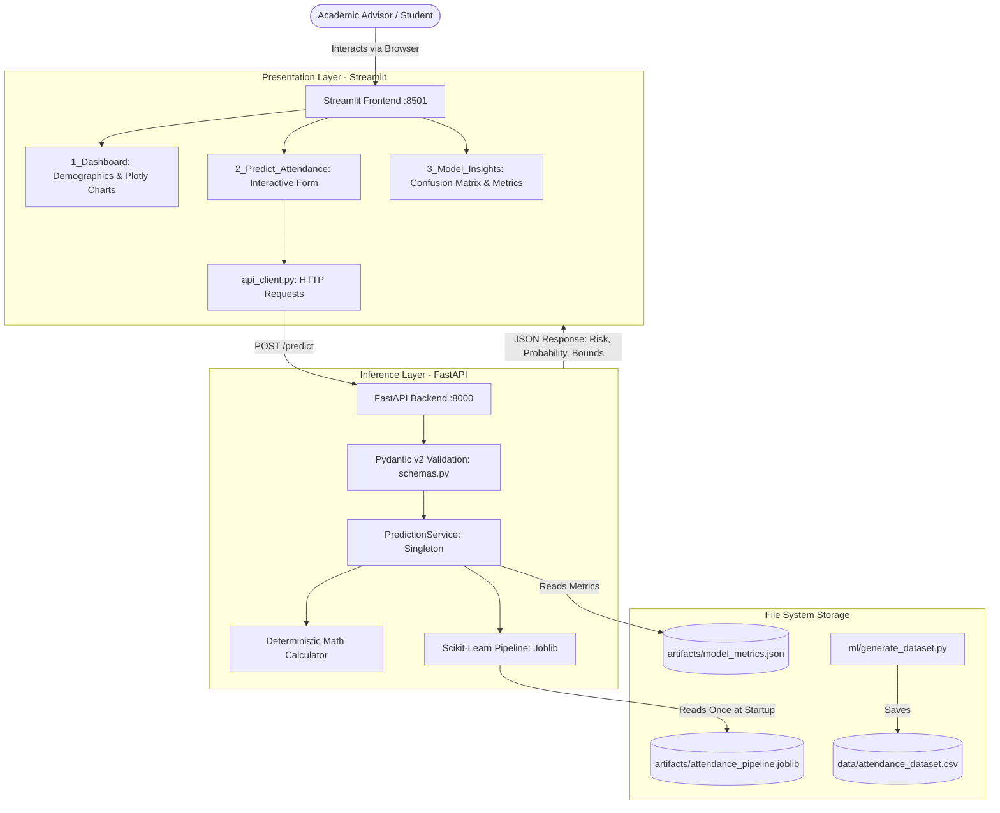

# Smart Attendance Prediction System Using Machine Learning

[](https://www.python.org/)
[](https://fastapi.tiangolo.com)
[](https://streamlit.io)
[](https://scikit-learn.org/)
[](https://pytest.org/)

An end-to-end, lightweight machine learning system that predicts whether a university student is at risk of finishing a semester below the mandatory **75% attendance threshold**.

Designed as a modern portfolio showcase, this project features a **Scikit-Learn ML pipeline**, a **FastAPI REST backend**, and an interactive **Streamlit frontend**, emphasizing zero target data leakage, transparent model explainability, and mathematical bounds.

---

## 1. Project Overview & Features

### Core Capabilities
- **Proactive Risk Prediction**: Predicts future semester attendance risk (`attendance_risk = 1` if $< 75\%$) rather than merely reporting backward-looking attendance percentages.
- **Strict Leakage Prevention**: Features capture only information available at the prediction checkpoint; future attendance outcomes are strictly isolated during training.
- **Separation of Deterministic Math & ML Probabilities**: Clearly differentiates mathematical limits (e.g., maximum achievable attendance) from probabilistic behavioral predictions.
- **Dual Model Comparison**: Evaluates a linear baseline (**Logistic Regression**) against a compact **Decision Tree Classifier** (~6 KB) using stratified 5-fold cross-validation and held-out test evaluation. No heavy ensembles (no Random Forest).
- **FastAPI REST Backend**: Pydantic v2 input validation, singleton in-memory model caching, and health probes.
- **Interactive Streamlit UI**: Multi-page analytics dashboard, prediction form with probability gauge, and model explainability cards.
- **Zero External Database Overhead**: Stores training data in CSV and serialized pipelines in Joblib. Runs efficiently on 8 GB RAM (MacBook Air M2).

---

## 2. Architecture & System Flow



---

## 3. Technology Stack

| Layer | Technologies | Justification |
|-------|--------------|---------------|
| **Frontend** | Streamlit, Plotly, Pandas | Rapid, interactive data visualization and responsive form handling in pure Python. |
| **Backend** | FastAPI, Uvicorn, Pydantic v2 | High-performance asynchronous REST API with automatic OpenAPI Swagger documentation. |
| **Machine Learning** | Scikit-learn, NumPy, Pandas, Joblib | Industry-standard tabular ML pipelines, column transformers, and serialization. |
| **Testing** | Pytest, FastAPI TestClient, HTTPX | Fast, isolated unit and integration testing without live servers or external databases. |
| **Storage** | CSV, JSON, Joblib | Lightweight, serverless local storage ideal for local machines and portfolio showcases. |

---

## 4. Folder Structure

```
Smart Student Attendence system/
├── backend/                      # FastAPI Application
│   ├── config.py                 # Configuration and environment variables
│   ├── dependencies.py           # Dependency injection for services
│   ├── main.py                   # FastAPI endpoints and lifespan
│   ├── schemas.py                # Pydantic v2 validation models
│   └── services/
│       └── prediction_service.py # Model loading, inference, and math bounds
├── frontend/                     # Streamlit User Interface
│   ├── app.py                    # Streamlit home landing page
│   ├── components/
│   │   ├── api_client.py         # HTTP client communicating with backend
│   │   └── ui_helpers.py         # Plotly charts, styles, and sidebar status
│   └── pages/
│       ├── 1_Dashboard.py        # Analytics and distribution charts
│       ├── 2_Predict_Attendance.py # Form, probability gauge, and recovery plan
│       └── 3_Model_Insights.py   # Metrics, confusion matrix, feature importance
├── ml/                           # Machine Learning Pipeline
│   ├── generate_dataset.py       # Zero-leakage synthetic simulation generator
│   ├── preprocessing.py          # ColumnTransformer & feature definitions
│   ├── evaluate.py               # Classification metrics & confusion matrix
│   └── train.py                  # Model training, CV, comparison & saving
├── data/                         # CSV datasets
│   └── attendance_dataset.csv
├── artifacts/                    # Serialized models and metrics
│   ├── attendance_pipeline.joblib
│   └── model_metrics.json
├── tests/                        # Automated Pytest suite
│   ├── test_schemas.py           # Pydantic constraint tests
│   ├── test_prediction.py        # Math bounds & prediction tests
│   └── test_api.py               # FastAPI TestClient endpoint tests
├── docs/                         # Detailed Technical Documentation
│   ├── ARCHITECTURE.md           # Architecture and request flow details
│   ├── API.md                    # REST API specifications and curl examples
│   └── ML_METHODOLOGY.md         # ML theory, metrics, and leakage prevention
├── .gitignore
├── .env.example
├── requirements.txt
├── README.md
├── PROJECT_PLAN.md
└── TASKS.md
```

---

## 5. Prerequisites & Environment Setup

### Prerequisites
- macOS, Linux, or Windows.
- Python 3.10, 3.11, 3.12, or 3.13.

### 1. Clone & Set Up Virtual Environment
```bash
# Navigate to the workspace directory
cd "Smart Student Attendence system"

# Create a virtual environment
python3 -m venv .venv

# Activate the virtual environment
# macOS / Linux:
source .venv/bin/activate
# Windows:
# .venv\Scripts\activate

# Upgrade pip and install dependencies
pip install --upgrade pip
pip install -r requirements.txt
```

---

## 6. Step-by-Step Execution Guide

### Step 1: Generate the Synthetic Dataset
Generate a reproducible, zero-leakage synthetic dataset simulating 2,500 students:
```bash
python -m ml.generate_dataset
# Or with Make:
# make generate-data
```
*Output: Saves `data/attendance_dataset.csv`.*

### Step 2: Train & Evaluate Machine Learning Models
Trains Logistic Regression and Random Forest models, performs 5-fold cross-validation, evaluates on a held-out test set, and saves the winning pipeline:
```bash
python -m ml.train
# Or with Make:
# make train
```
*Output: Saves `artifacts/attendance_pipeline.joblib` and `artifacts/model_metrics.json`.*

### Step 3: Run the FastAPI Backend
Start the high-performance prediction server:
```bash
uvicorn backend.main:app --reload --port 8000
# Or with Make:
# make run-backend
```
- API Base: `http://127.0.0.1:8000`
- Interactive Swagger UI: `http://127.0.0.1:8000/docs`

### Step 4: Run the Streamlit Frontend
In a **new terminal tab** (with your `.venv` activated), launch the UI:
```bash
streamlit run frontend/app.py
# Or with Make:
# make run-frontend
```
- Frontend URL: `http://localhost:8501`

### Step 5 (Optional): Test API with Demo Script
With the FastAPI server running, you can run automated scenario predictions from Python:
```bash
python scripts/demo_predict.py
```

---

## 7. Running Automated Tests

Run the comprehensive test suite verifying schemas, deterministic calculations, inference integrity, and API endpoints:

```bash
pytest -v
```

All 22 unit and integration tests execute in under 2 seconds.

---

## 8. Example API Request & Response

### Example `curl` Request
```bash
curl -X POST "http://127.0.0.1:8000/predict" \
     -H "Content-Type: application/json" \
     -d '{
       "classes_conducted": 50,
       "classes_attended": 34,
       "classes_remaining": 20,
       "previous_attendance_trend": "declining",
       "consecutive_absences_recent": 2,
       "participation_score": 6.5
     }'
```

### Example JSON Response
```json
{
  "attendance_risk": 1,
  "risk_label": "At Risk",
  "risk_probability": 0.8124,
  "target_threshold": 75.0,
  "explanation": "The model estimates an elevated risk (81.2% probability) of finishing below 75%. Key contributing patterns: current attendance is below threshold (68.0%), attendance trend has been declining recently, student has 2 recent consecutive absences. To reach 75%, the student must attend at least 19 of the remaining 20 classes (95.0% future attendance rate).",
  "deterministic_bounds": {
    "current_attendance_pct": 68.0,
    "total_semester_classes": 70,
    "max_possible_attendance_pct": 77.14,
    "min_possible_attendance_pct": 48.57,
    "classes_needed_for_75_pct": 19,
    "mathematical_status": "behavior_dependent"
  }
}
```

---

## 9. Key Machine Learning Concepts Explained

### 1. Why Prioritize Recall over Accuracy?
In university early-warning systems, class imbalance is normal (~23% at-risk, 77% safe). If a model predicts "Safe" for every student, it achieves 77% accuracy while missing every student in danger.
- **False Negative**: An at-risk student is missed, leading to debarment from exams.
- **False Positive**: A safe student receives a friendly advisory email.
- **Conclusion**: We optimize for high **Recall (93.9%)** on the at-risk class while maintaining high **Precision (90.8%)** to avoid alert fatigue.

### 2. Physical Constraints & Input Sanitization
A student cannot attend 45 classes if only 40 were conducted. Pydantic v2 root validators enforce `classes_attended <= classes_conducted` and reject contradictory payloads with HTTP 422 before the data ever reaches the ML model.

### 3. Separation of Concerns
The Streamlit frontend never imports the ML model or Scikit-learn directly. It communicates with FastAPI strictly over HTTP. If you scale the backend to a cloud cluster in the future, the frontend code remains unchanged.

---

## 10. Troubleshooting

| Issue | Cause | Solution |
|-------|-------|----------|
| `Connection Failed: Could not connect to FastAPI at http://127.0.0.1:8000` | Backend server is not running | Run `uvicorn backend.main:app --port 8000` in a separate terminal. |
| `HTTP 503: Model artifact is not available` | Model pipeline has not been trained yet | Run `python -m ml.train` to generate `artifacts/attendance_pipeline.joblib`. |
| `Validation Error: classes_attended cannot exceed classes_conducted` | Contradictory input counts | Check input values; attended classes must be $\le$ conducted classes. |

---

## 11. Limitations & Future Roadmap

### Current Limitations
- **Synthetic Data**: Trained on simulated behavioral trajectories. Real-world validation requires institutional partnership.
- **No Long-term Persistence**: Predictions are served in real-time and not stored in a permanent database.

### Future Improvements
1. **Time-series Recurrent Models (LSTM / Transformers)**: Incorporate weekly attendance sequences rather than summary trends.
2. **Automated Notification Webhooks**: Trigger automated Slack/email check-ins for students whose risk probability exceeds 75%.
3. **Multi-Course Aggregation**: Aggregate attendance risk across multiple concurrent course modules.

